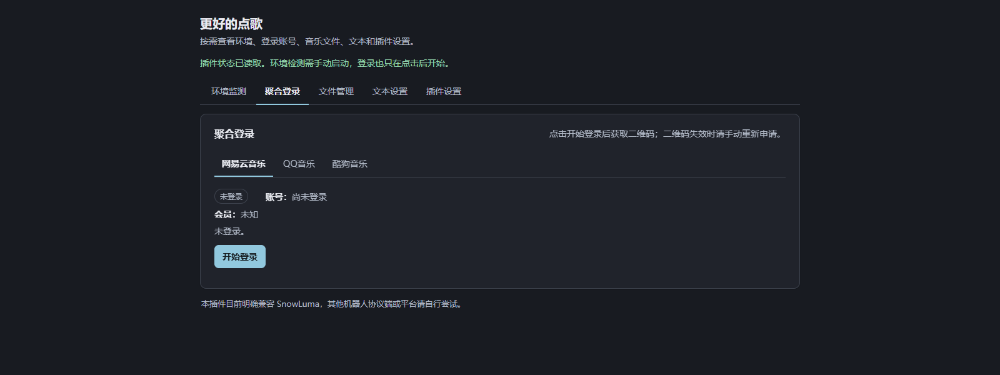
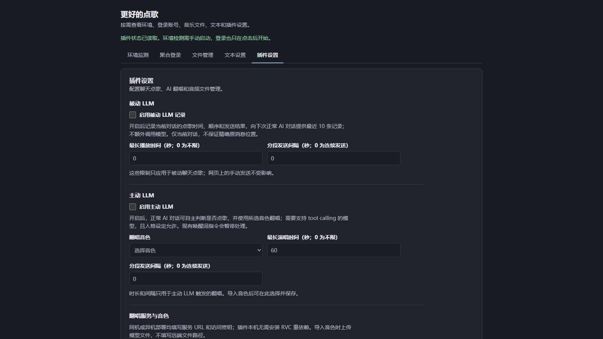

# 更好的点歌

**AstrBot 的 QQ 点歌插件**，可搜索并分段发送网易云音乐、酷狗音乐和 QQ 音乐的歌曲。可选接入外部兼容 HTTP 服务，为歌曲生成翻唱语音。普通点歌无需配置推理服务，也不要求额外调用 LLM。

- 版本：1.0.0
- [源码仓库](https://github.com/Nortea575/astrbot_plugin_better_music)
- [翻唱服务接入与接口说明](cover_deployment.md)

## 界面预览



*界面示例：未接入真实账号。*



*界面示例：设置为默认关闭状态，未接入真实账号。*

## 主要功能

- 在“聚合登录”页登录或退出网易云音乐、酷狗音乐和 QQ 音乐账号；点击登录按钮后才会生成二维码，并显示登录与会员状态。
- 在聊天中搜索歌曲、查看最多五条候选，选择后下载并按顺序分段发送。
- 可选启用主动 LLM：在 AstrBot 的 LLM 对话中，由模型决定是否调用唱歌工具；这会暂停固定点歌指令。
- 可选启用被动 LLM：向当前会话的后续对话提供已发送歌曲的时间与先后记录，不额外触发一次模型调用。
- 自定义聊天回复、回复提示开关、点歌日志目标和分段播放限制。
- 在“文件管理”页按平台查看文件，手动发送原曲或可用翻唱缓存；本机已有的歌曲与翻唱结果可复用。

## 快速开始

### 环境要求

- AstrBot 4.29.3 或更高版本，并配置可用于 QQ 的消息平台。已适配 SnowLuma；其他 OneBot/QQ 实现可自行尝试。
- 可运行的 FFmpeg 与 FFprobe，以及 Node.js 22 或更高版本。环境页可检查依赖并补齐部分工具。
- AstrBot 插件依赖：QQ 音乐登录所用的 Python 包、二维码生成包和异步 HTTP 客户端；AstrBot 可根据 `requirements.txt` 安装。

普通点歌不需要 LLM 或翻唱推理服务。主动 LLM 还需支持工具调用（tool calling）的模型，以及符合接口约定的外部翻唱服务和可用音色。

### 安装

在 AstrBot 插件管理中使用[本仓库地址](https://github.com/Nortea575/astrbot_plugin_better_music)安装；也可以下载发布 ZIP，将插件文件解压到名为 `astrbot_plugin_better_music` 的目录，再放入 AstrBot 插件目录。两种方式任选其一。

安装后启动或重启 AstrBot，在插件管理页启用插件，再从侧边栏打开“更好的点歌”。进入“环境监测”页，按需安装或配置 FFmpeg、FFprobe、Node.js 和音乐平台依赖；再到“聚合登录”页完成所需平台的登录。

环境页提供常规依赖检查和安装。FFmpeg、Node.js 的默认下载包覆盖 Windows/Linux x64；其他系统或架构需自行提供匹配的工具包。自定义下载地址必须对应当前系统并符合工具要求，不能视为所有系统均可一键安装。

## 使用说明

### 聊天点歌

以下 `%A` 仅作示例，请替换为当前 AstrBot 会话配置的唤醒前缀：

```text
%A点歌
%A搜索 歌名
%A播放 1
```

关闭主动 LLM 时，固定指令按“网易云音乐 → 酷狗音乐 → QQ 音乐”的顺序查找已验证登录的账号，只搜索优先级最高的一个平台，并返回最多五条结果。播放序号须在五分钟内、由发起搜索的同一会话和用户选择；超时或重新搜索后请使用新结果。

启用主动 LLM 后，固定点歌指令会暂停。在 AstrBot 的 LLM 对话中，模型决定是否调用唱歌工具；调用后会搜索歌曲、选择候选并提交翻唱，后台生成完成后按序分段发送。

被动 LLM 与主动 LLM 使用独立开关。被动模式按当前会话保存点歌时间与顺序，供后续正常对话参考；它本身不额外发起模型调用。被动播放时长和片段间隔只影响聊天点歌，主动演唱使用独立的限制设置。

### 分段、缓存与日志

音频会转换并切成每段不超过 60 秒的语音。配置片段间隔后，插件会在上一段发送成功后等待再发送下一段。主动与被动播放的时长上限和间隔可分别设置。

歌曲、原曲、语音分段与对应翻唱结果保存在插件根目录的 `downloads/` 中，同一歌曲的原曲与翻唱归在同一歌曲目录。本机已有的歌曲和适配当前设置的翻唱缓存可复用。默认最多保留 30 首歌曲，按所有音乐平台合计；超出上限时按下载时间清理较早的歌曲及其文件。设置、账号和会话记录保存在 `data/` 中。

聊天回复模板可编辑，每类回复可以单独启用或关闭。点歌日志也有独立开关；启用后需指定机器人实例及接收日志的私聊或群聊目标。

更新或重装前，如需保留设置、登录状态或歌曲文件，请分别备份插件的 `data/` 和 `downloads/`。

### 翻唱服务

翻唱是可选功能。插件会把歌曲音频提交给外部兼容 HTTP 服务，并按约定接收结果及确认清理。仓库不提供该服务的实现、推理模型或训练权重；普通点歌不受此项影响。并非任意 RVC 服务都能直接连接，服务必须实现[接口说明](cover_deployment.md)中约定的版本、任务状态和 ACK/DELETE/TTL 清理行为。

歌曲搜索和播放能力受各音乐平台、账号权限及其规则限制；插件不绕过会员权限或平台风控。

## 反馈、授权与依赖

问题反馈请提交到[项目 Issues](https://github.com/Nortea575/astrbot_plugin_better_music/issues)。插件作者：Xing。

本插件按 **GPL-3.0** 授权，完整许可文本见 [`LICENSE`](LICENSE)。

依赖与致谢：网易云音乐接口 [NeteaseCloudMusicApiEnhanced/api-enhanced](https://github.com/NeteaseCloudMusicApiEnhanced/api-enhanced)（MIT）；QQ 音乐接口 [L-1124/QQMusicApi](https://github.com/L-1124/QQMusicApi)（GPL-3.0-or-later）；酷狗音乐接口 [MakcRe/KuGouMusicApi](https://github.com/MakcRe/KuGouMusicApi)（MIT）；Python 包 [qrcode](https://pypi.org/project/qrcode/) 和 [aiohttp](https://docs.aiohttp.org/en/stable/)。各依赖均按其自身许可使用。
